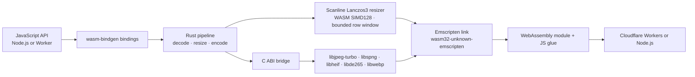

# Mutables Image Optimizer

[](https://www.npmjs.com/package/@mutables.app/image-optimizer)
[](https://www.npmjs.com/package/@mutables.app/image-computer)

**Current input support:** baseline JPEG, Lowzag-compatible progressive JPEG, non-interlaced PNG, WebP, and tiled/grid HEIC/HEIF. WebP is limited to 12 MP; resized WebP inputs use a reduced-output decode with `speed: 'fast'`. Other progressive/multi-scan JPEGs (including CMYK and YCCK), Adam7/interlaced PNG, non-grid HEIC/HEIF, and AVIF are rejected.

An image-processing pipeline written in Rust and compiled to WebAssembly for Node.js and Cloudflare Workers. It links JPEG, PNG, HEIF/HEIC, and WebP codec libraries into the same Emscripten module as the Rust resize pipeline, so the image pixels stay inside WASM instead of crossing between JavaScript libraries at each stage.

```js
import { image } from '@mutables.app/image-optimizer';

const webp = await image(inputBytes)
  .resize(800, 600, { fit: 'inside', withoutEnlargement: true })
  .webp({ quality: 80, speed: 'fast' })
  .bytes();
```

`speed: 'fast'` selects a faster internal WebP encoder setting, enables scaled JPEG decoding, and for resized WebP inputs decodes to an intermediate surface at up to 2× the requested output dimensions before Lanczos resizing. Lowzag-compatible progressive JPEGs can be resized up to 48 megapixels using scale-aware coefficient decoding. Other progressive/multi-scan JPEGs, including CMYK and YCCK, are rejected. Baseline JPEG and non-interlaced PNG inputs support up to 48 megapixels; tiled/grid HEIC/HEIF supports up to 48 megapixels. WebP input supports up to 12 megapixels. Adam7/interlaced PNG and non-grid HEIC/HEIF inputs are rejected. `maxPixels` bounds the output (8 million by default). PNG inputs and `lossless: true` requests retain full-resolution source decoding. Omit `speed` to keep the default WebP encoder setting and full-resolution WebP input decoding. The fast path can produce different output pixels and file sizes; the trade-off depends on the image. `.blob()` returns an `image/webp` Blob, or `image/jpeg` after `.jpeg()`. Image work runs synchronously in the isolate, inside the returned promise.

## Architecture

The project uses the `wasm32-unknown-emscripten` Rust target with wasm-bindgen’s Emscripten integration. Emscripten links the Rust pipeline and native codec libraries compiled for WebAssembly into one module; the generated JavaScript glue loads that module in Workers or Node.js. This is the integration described in [Cloudflare’s Emscripten target announcement](https://blog.cloudflare.com/rust-workers-emscripten-target/).



JPEG, non-interlaced PNG, WebP, and tiled/grid HEIC/HEIF decoding, resizing, and WebP/JPEG encoding execute in the compiled module. Baseline JPEG and non-interlaced PNG inputs are decoded sequentially. WebP input is capped at 12 MP; default decoding retains a full RGBA surface, while resized `speed: 'fast'` requests use libwebp's scaled-output decoder at up to 2× target size before the Rust Lanczos3 row resizer. Tiled HEIF grids decode one tile row at a time and support up to 48 megapixels. Adam7/interlaced PNG and non-grid HEIC/HEIF inputs are rejected; AVIF input is also unsupported. The Rust Lanczos3 resizer retains a bounded set of rows and uses premultiplied alpha through both passes, with SIMD128 for four-channel convolution.

WebP encoding needs the complete **resized** RGBA image; the source image is not accumulated by the row resizer. JPEG output feeds each resized row directly into a baseline libjpeg-turbo encoder, with standard Huffman tables and 4:2:0 subsampling. Input and encoded output bytes are still buffered by `.bytes()`/`.blob()`; this is internal pixel processing, not a streaming HTTP API.

Only Lowzag-compatible progressive JPEGs are supported; other progressive/multi-scan variants, including CMYK and YCCK, are rejected before coefficient buffering. The old `fast_image_resize` implementation remains only as a low-level benchmark reference, not the public processing path. The codec libraries are **compiled to WebAssembly**; they are not native host binaries running outside the Worker sandbox. Workers load the Wasm module statically. Node.js uses a separate file-based loader. The optional Computer adapter sits around the same optimizer and reads and writes files through `workspace.fs`.

Cloudflare describes the Emscripten Rust target support as an experimental preview. This project demonstrates the image-processing use case; it does not imply native machine-code execution or guarantee a performance gain over other Workers image libraries. HEIF decoding adds LGPL-licensed libheif and libde265; their license notices are included in the optimizer package.

## Packages

### [`@mutables.app/image-optimizer`](https://www.npmjs.com/package/@mutables.app/image-optimizer)

Accepts a `Blob`, `ArrayBuffer`, or typed array. Baseline JPEG, Lowzag-compatible progressive JPEG, non-interlaced PNG, WebP (up to 12 MP), and tiled/grid HEIF/HEIC input are sniffed automatically. Adam7/interlaced PNG, non-grid HEIF/HEIC, and AVIF are rejected. Tiled HEIF grids support up to 48 megapixels. Width-only resizing preserves aspect ratio; two dimensions default to `fill`.

```js
import { image } from '@mutables.app/image-optimizer';

const bytes = await image(inputBytes)
  .resize(800, 600, { fit: 'inside', withoutEnlargement: true })
  .webp({ quality: 80 })
  .bytes();
```

JPEG output uses the same resize options:

```js
const jpeg = await image(inputBytes)
  .resize(1200, 1200, { fit: 'inside', withoutEnlargement: true })
  .jpeg({ quality: 80 }) // optional speed: 'fast' enables scaled JPEG decoding
  .bytes();
```

JPEG has no alpha: transparent pixels are composited onto white. `.webp({lossless:true})` selects lossless WebP encoding; resizing itself still changes pixels. JPEG output is baseline lossy JPEG.

### [`@mutables.app/image-computer`](https://www.npmjs.com/package/@mutables.app/image-computer)

An optional adapter for [Cloudflare Computer](https://www.npmjs.com/package/@cloudflare/computer). It reads an image from the Computer workspace, runs the same WASM optimizer in the Worker, then writes the result back to the workspace filesystem.

```js
import { optimizeWorkspaceImage } from '@mutables.app/image-computer';

await optimizeWorkspaceImage(workspace, '/input.jpg', '/output.webp', {
  width: 800,
  height: 600,
  fit: 'inside',
  quality: 80,
  speed: 'fast',
});
```

Set `format: 'jpeg'` for JPEG output; WebP is the default. The returned `contentType` matches the selected format.

The adapter accepts a Computer Workspace or compatible object with `fs.readFile` and `fs.writeFile`. Streamed reads are bounded before buffering. Input and output paths must differ; an existing output file is overwritten.

## Performance evidence

The published v0.1.0 Worker benchmark (before scanlines) compares two internal WebP encoder settings on three photos at 320, 800, and 1600 pixels. All 288 image requests returned valid WebP. The `speed: 'fast'` setting had lower median CPU in six of nine image-size cases and in all three 1600-pixel cases, while its files were about 2–12% larger. CPU traces were sampled and uneven across cases. These results are preliminary, image-specific measurements—not a comparison against Bun or other optimizers. See [the full benchmark notes](benchmarks/experiments/RESULTS.md). These CPU results do not establish the performance of the new row pipeline; [scanline comparisons](benchmarks/scanlines/RESULTS.md) are tracked separately.

## Limits

- JPEG, PNG, WebP, and HEIC/HEIF input; WebP and JPEG output. No animation, rotation, or metadata API.

| Input type | Maximum source pixels | Decode path | WASM linear-memory capacity | Cloudflare isolate memory (max sampled) |
| --- | ---: | --- | ---: | ---: |
| Baseline JPEG | 48 MP | Sequential scanline decode; eligible resized JPEGs can use scaled decode with `speed: 'fast'`. | 16 MiB | 36.14 MiB |
| Non-interlaced PNG | 48 MP | Sequential scanline decode. | 16 MiB | 21.17 MiB |
| Lowzag-compatible progressive JPEG | 48 MP | Reduced coefficient decode when resizing; coefficient planes are checked before full-resolution fallback. | 27.75 MiB | 43.23 MiB |
| WebP, default decode | 12 MP | Full RGBA decode before resizing. | 66.56 MiB | 98.08 MiB (4 samples) |
| WebP, `speed: 'fast'` resized decode | 12 MP | libwebp scaled output at up to 2× target size, then Lanczos resizing. | 19.25 MiB | 39.36 MiB (4 samples) |
| Tiled/grid HEIC/HEIF | 48 MP | libde265 (HEVC); decodes one tile row at a time. | 49 MiB | 54.97 MiB |

### Worker response time and CPU

These end-to-end samples convert supported synthetic inputs to 800×600 WebP. Each fixture ran in its own temporary Worker with one warm-up request followed by three measured requests. Response time is client-observed p50 and includes network and transfer time; CPU is the median per-invocation `cpuTime` reported by Wrangler tail. Wrangler captured one to three CPU samples per fixture; the sample count appears beside each CPU median. The temporary Workers used a 30-second CPU limit.

| Input path and source size | Result | Response p50 | Worker CPU median | WASM capacity after last request |
| --- | --- | ---: | ---: | ---: |
| Baseline JPEG, 12 MP | Converted | 234 ms | 111 ms (1 sample) | 16 MiB |
| Baseline JPEG, 24 MP | Converted | 367 ms | 198 ms (1 sample) | 16 MiB |
| Baseline JPEG, 48 MP | Converted | 630 ms | 346 ms (3 samples) | 16 MiB |
| Non-interlaced PNG, 12 MP | Converted | 469 ms | 381 ms (3 samples) | 16 MiB |
| Non-interlaced PNG, 24 MP | Converted | 547 ms | 426 ms (3 samples) | 16 MiB |
| Non-interlaced PNG, 48 MP | Converted | 1,047 ms | 932 ms (3 samples) | 16 MiB |
| Lowzag progressive JPEG, 12 MP | Converted | 671 ms | 438 ms (3 samples) | 16 MiB |
| Lowzag progressive JPEG, 24 MP | Converted | 708 ms | 498 ms (3 samples) | 27.75 MiB |
| Lowzag progressive JPEG, 48 MP | Converted | 1,359 ms | 1,032 ms (3 samples) | 27.75 MiB |
| Tiled/grid HEIC/HEIF, 12 MP | Converted | 962 ms | 710 ms (3 samples) | 16 MiB |
| Tiled/grid HEIC/HEIF, 24 MP | Converted | 885 ms | 734 ms (3 samples) | 36.88 MiB |
| Tiled/grid HEIC/HEIF, 48 MP | Converted | 1,570 ms | 1,417 ms (3 samples) | 48.63 MiB |

See the [raw Worker performance results](benchmarks/decoder-performance-worker.json) and [memory measurements](benchmarks/decoder-memory-worker.json). Both reports keep measurements for unsupported Adam7 PNG, non-grid HEIC/HEIF, and non-Lowzag progressive JPEG paths in `historicalUnsupportedResults`; those results do not describe current support. These small synthetic-fixture samples show this test run, not guaranteed production latency.

#### WebP input by source size

These 2, 6, and 12 MP synthetic WebP fixtures were resized to fit within 800×600 and encoded as WebP. Each size/mode ran in a fresh Worker with one initial request and three warm requests. Response p50 uses the warm requests. CPU and isolate-memory sample counts show the invocations Cloudflare returned; isolate memory is `memoryUsageBytesP99`, not exact peak RSS.

| WebP source | Decode mode | Response p50 | Worker CPU median | WASM capacity | Worker isolate memory, max sampled |
| ---: | --- | ---: | ---: | ---: | ---: |
| 2 MP | Default full decode | 552 ms | 488 ms (2 samples) | 16.00 MiB | 23.58 MiB (2 samples) |
| 2 MP | `speed: 'fast'` scaled decode | 402 ms | 234 ms (2 samples) | 16.00 MiB | 26.96 MiB (3 samples) |
| 6 MP | Default full decode | 1117 ms | 905 ms (2 samples) | 33.50 MiB | 57.63 MiB (2 samples) |
| 6 MP | `speed: 'fast'` scaled decode | 836 ms | 597 ms (3 samples) | 16.00 MiB | 33.12 MiB (3 samples) |
| 12 MP | Default full decode | 1617 ms | 1120 ms (1 sample) | 66.56 MiB | 86.83 MiB (1 sample) |
| 12 MP | `speed: 'fast'` scaled decode | 1190 ms | 881 ms (2 samples) | 19.25 MiB | 55.59 MiB (3 samples) |

The 2 MP fixture is 2000×1000, the 6 MP fixture is 3000×2000, and the 12 MP fixture is 4000×3000. Cloudflare isolate-memory samples varied between runs and sometimes arrived for only part of the requests; use them as observed samples, not guaranteed peaks. See the [raw WebP input Worker results](benchmarks/webp-input-worker.json).

A separate WebP-input Worker comparison used an 8.24 MiB synthetic 12 MP WebP and 800×600 JPEG output, with one initial request and three warm requests per fresh Worker. Median client round trip was 1,454 ms for full decoding and 1,318 ms for `speed: 'fast'`. WASM capacity was 66.56 MiB and 19.25 MiB; Cloudflare reported a maximum sampled isolate memory of 98.08 MiB and 39.36 MiB across four successful invocations per mode. These are sampled `memoryUsageBytesP99` values, not exact peak RSS. A photo-derived 12 MP fixture produced 39.28 dB PSNR between the fast scaled-decode output and the full-decode output; results vary by image. Raw samples are in [the Worker memory report](benchmarks/decoder-memory-worker.json).

All formats share a 20 MiB input limit and a 16,383-pixel dimension limit. The default output pixel limit (`maxPixels`) is 8 MP and can be raised to 16 MP. Adam7/interlaced PNG and non-grid HEIC/HEIF are unsupported. WASM capacity is not total Worker memory. Cloudflare's per-invocation isolate-memory metric includes shared JavaScript and WebAssembly memory, but is sampled at invocation time rather than measuring exact peak memory. Cloudflare Worker isolates have a 128 MiB total limit.

Worker measurements use synthetic fixtures and 800×600 WebP output. Cloudflare `memoryUsageBytesP99` samples are correlated by request time and colo; they are observed isolate-memory measurements, not exact peaks. Unsupported progressive JPEG measurements remain in the report's `historicalUnsupportedResults`. See [the Worker measurements and fixture results](benchmarks/decoder-memory-worker.json); rerun with `node scripts/benchmark-decoder-memory-worker.mjs`.

- PNG alpha is preserved in WebP; JPEG composites onto white. EXIF orientation and ICC color management are not applied; metadata is not copied. JPEGs with decoder warnings are rejected.
- Resizing uses scanline Lanczos3 with premultiplied alpha. `speed: 'fast'` enables scaled JPEG decoding for eligible resized lossy requests.

## Development

Prerequisites: Python 3.12+, CMake 3.16+, Make, Rust beta with `wasm32-unknown-emscripten`, Emscripten **6.0.10**, wasm-bindgen CLI **0.2.129**, and Pillow for independent image verification in tests. The build downloads pinned codec source releases. Set `EMSDK` to the SDK directory and `EM_CONFIG` to its generated config file; set `CMAKE` if CMake is outside `PATH`.

```sh
export EMSDK=/path/to/emsdk
export EM_CONFIG=/path/to/emscripten.config
./scripts/build.sh
npm test
npm run check:worker
```

Run `node scripts/benchmark-scanlines.mjs` for matched local A/B measurements in separate processes. It records local CPU, wall time, high-water WASM memory capacity, row-storage estimates and output sizes. This is separate from deployed Cloudflare CPU measurements.

To try the local Worker and Computer integration:

```sh
npm install
npm run dev
curl -X POST --data-binary @test/fixtures/input.jpg 'http://localhost:8787/optimize?width=80&speed=fast' -o /tmp/direct.webp
```

`npm run test:worker` exercises the Computer storage flow while the dev server is running. The Worker example has no authentication or workspace authorization; secure it before exposing it. Build details, codec flags, test requirements, and benchmark artifacts are documented in the repository.

This repository contains source packages and examples; it does not deploy or operate a public image-processing service. No Cloudflare deployment is performed by the build or test scripts.
