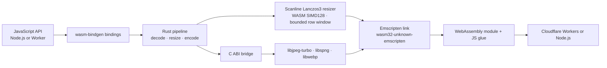

# Mutables Image Optimizer

[](https://www.npmjs.com/package/@mutables.app/image-optimizer)
[](https://www.npmjs.com/package/@mutables.app/image-computer)

**New in v0.2.0:** scanline decoding/resizing in both speed modes, JPEG output and lower peak memory for large resizes. The benchmarks show a CPU trade-off; this release focuses on memory efficiency.

An image-processing pipeline written in Rust and compiled to WebAssembly for Node.js and Cloudflare Workers. It links JPEG, PNG, and WebP codec libraries into the same Emscripten module as the Rust resize pipeline, so the image pixels stay inside WASM instead of crossing between JavaScript libraries at each stage.

```js
import { image } from '@mutables.app/image-optimizer';

const webp = await image(inputBytes)
  .resize(800, 600, { fit: 'inside', withoutEnlargement: true })
  .webp({ quality: 80, speed: 'fast' })
  .bytes();
```

`speed: 'fast'` selects a faster internal WebP encoder setting and enables scaled JPEG decoding for resized images when the target permits it. That can avoid decoding every source pixel and reduce peak pixel-buffer memory for large JPEGs. All JPEG/PNG sources are capped at 16 megapixels; `maxPixels` bounds the output (8 million by default). PNG inputs and `lossless: true` requests retain full-resolution row decoding. Omit `speed` to keep the existing WebP encoder setting; scanline processing applies in both modes. The fast path can produce larger files; the trade-off depends on the image. `.blob()` returns an `image/webp` Blob, or `image/jpeg` after `.jpeg()`. Image work runs synchronously in the isolate, inside the returned promise.

## Architecture

The project uses the `wasm32-unknown-emscripten` Rust target with wasm-bindgen’s Emscripten integration. Emscripten links the Rust pipeline and native codec libraries compiled for WebAssembly into one module; the generated JavaScript glue loads that module in Workers or Node.js. This is the integration described in [Cloudflare’s Emscripten target announcement](https://blog.cloudflare.com/rust-workers-emscripten-target/).



JPEG and PNG decoding, resizing, and WebP/JPEG encoding execute in the compiled module. Baseline JPEG and non-interlaced PNG inputs are decoded sequentially. The Rust Lanczos3 resizer retains a bounded set of rows and uses premultiplied alpha through both passes, with SIMD128 for four-channel convolution. This happens for both the default and `speed: 'fast'` settings.

WebP encoding needs the complete **resized** RGBA image; the source image is not accumulated by the row resizer. JPEG output feeds each resized row directly into a baseline libjpeg-turbo encoder, with standard Huffman tables and 4:2:0 subsampling. Input and encoded output bytes are still buffered by `.bytes()`/`.blob()`; this is internal pixel processing, not a streaming HTTP API.

Progressive/multi-scan JPEGs require codec coefficient storage. Adam7 PNGs use a bounded full-image decode for compatibility before entering the row resizer. These inputs retain more memory than baseline JPEG/non-interlaced PNG. The old `fast_image_resize` implementation remains only as a low-level benchmark reference, not the public processing path. The codec libraries are **compiled to WebAssembly**; they are not native host binaries running outside the Worker sandbox. Workers load the Wasm module statically. Node.js uses a separate file-based loader. The optional Computer adapter sits around the same optimizer and reads and writes files through `workspace.fs`.

Cloudflare describes the Emscripten Rust target support as an experimental preview. This project demonstrates the image-processing use case; it does not imply native machine-code execution or guarantee a performance gain over other Workers image libraries.

## Packages

### [`@mutables.app/image-optimizer`](https://www.npmjs.com/package/@mutables.app/image-optimizer)

Accepts a `Blob`, `ArrayBuffer`, or typed array. JPEG and PNG input are sniffed automatically. Width-only resizing preserves aspect ratio; two dimensions default to `fill`.

```js
import { image } from '@mutables.app/image-optimizer';

const bytes = await image(inputBytes)
  .resize(800, 600, { fit: 'inside', withoutEnlargement: true })
  .webp({ quality: 80 })
  .bytes();
```

JPEG output uses the same resize options:

```js
const jpeg = await image(inputBytes)
  .resize(1200, 1200, { fit: 'inside', withoutEnlargement: true })
  .jpeg({ quality: 80 }) // optional speed: 'fast' enables scaled JPEG decoding
  .bytes();
```

JPEG has no alpha: transparent pixels are composited onto white. `.webp({lossless:true})` selects lossless WebP encoding; resizing itself still changes pixels. JPEG output is baseline lossy JPEG.

### [`@mutables.app/image-computer`](https://www.npmjs.com/package/@mutables.app/image-computer)

An optional adapter for [Cloudflare Computer](https://www.npmjs.com/package/@cloudflare/computer). It reads an image from the Computer workspace, runs the same WASM optimizer in the Worker, then writes the result back to the workspace filesystem.

```js
import { optimizeWorkspaceImage } from '@mutables.app/image-computer';

await optimizeWorkspaceImage(workspace, '/input.jpg', '/output.webp', {
  width: 800,
  height: 600,
  fit: 'inside',
  quality: 80,
  speed: 'fast',
});
```

Set `format: 'jpeg'` for JPEG output; WebP is the default. The returned `contentType` matches the selected format.

The adapter accepts a Computer Workspace or compatible object with `fs.readFile` and `fs.writeFile`. Streamed reads are bounded before buffering. Input and output paths must differ; an existing output file is overwritten.

## Performance evidence

The published v0.1.0 Worker benchmark (before scanlines) compares two internal WebP encoder settings on three photos at 320, 800, and 1600 pixels. All 288 image requests returned valid WebP. The `speed: 'fast'` setting had lower median CPU in six of nine image-size cases and in all three 1600-pixel cases, while its files were about 2–12% larger. CPU traces were sampled and uneven across cases. These results are preliminary, image-specific measurements—not a comparison against Bun or other optimizers. See [the full benchmark notes](benchmarks/experiments/RESULTS.md). These CPU results do not establish the performance of the new row pipeline; [scanline comparisons](benchmarks/scanlines/RESULTS.md) are tracked separately.

## Limits

- JPEG and PNG input; WebP and JPEG output. No animation, HEIC, AVIF, rotation, or metadata API.
- 20 MiB maximum input and 16 million source pixels. The default output pixel limit (`maxPixels`) is 8 million and can be raised to 16 million. Source and output dimensions are limited to 16383; WASM memory is capped at 256 MiB. Codec allocations and large outputs can still exceed a Worker’s available memory.
- PNG alpha is preserved in WebP; JPEG composites onto white. EXIF orientation and ICC color management are not applied; metadata is not copied. JPEGs with decoder warnings are rejected.
- Resizing uses scanline Lanczos3 with premultiplied alpha. `speed: 'fast'` enables scaled JPEG decoding for eligible resized lossy requests; the 16-megapixel source ceiling applies in both modes.

## Development

Prerequisites: Python 3.12+, CMake 3.16+, Make, Rust beta with `wasm32-unknown-emscripten`, Emscripten **6.0.10**, wasm-bindgen CLI **0.2.129**, and Pillow for independent image verification in tests. The build downloads pinned codec source releases. Set `EMSDK` to the SDK directory and `EM_CONFIG` to its generated config file; set `CMAKE` if CMake is outside `PATH`.

```sh
export EMSDK=/path/to/emsdk
export EM_CONFIG=/path/to/emscripten.config
./scripts/build.sh
npm test
npm run check:worker
```

Run `node scripts/benchmark-scanlines.mjs` for matched local A/B measurements in separate processes. It records local CPU, wall time, high-water WASM memory capacity, row-storage estimates and output sizes. This is separate from deployed Cloudflare CPU measurements.

To try the local Worker and Computer integration:

```sh
npm install
npm run dev
curl -X POST --data-binary @test/fixtures/input.jpg 'http://localhost:8787/optimize?width=80&speed=fast' -o /tmp/direct.webp
```

`npm run test:worker` exercises the Computer storage flow while the dev server is running. The Worker example has no authentication or workspace authorization; secure it before exposing it. Build details, codec flags, test requirements, and benchmark artifacts are documented in the repository.

This repository contains source packages and examples; it does not deploy or operate a public image-processing service. No Cloudflare deployment is performed by the build or test scripts.
