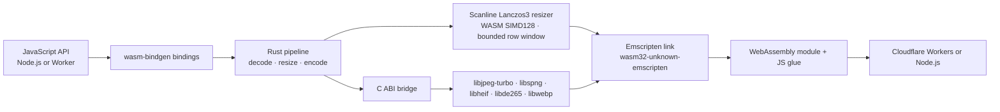

# Mutables Image Optimizer

[](https://www.npmjs.com/package/@mutables.app/image-optimizer)
[](https://www.npmjs.com/package/@mutables.app/image-computer)

**Current input support:** baseline JPEG, Lowzag-compatible progressive JPEG, non-interlaced PNG, WebP, and tiled/grid HEIC/HEIF. WebP is limited to 12 MP; resized WebP inputs use a reduced-output decode with `speed: 'fast'`. Other progressive/multi-scan JPEGs (including CMYK and YCCK), Adam7/interlaced PNG, non-grid HEIC/HEIF, and AVIF are rejected.

An image-processing pipeline written in Rust and compiled to WebAssembly for Node.js and Cloudflare Workers. It links JPEG, PNG, HEIF/HEIC, and WebP codec libraries into the same Emscripten module as the Rust resize pipeline, so the image pixels stay inside WASM instead of crossing between JavaScript libraries at each stage.

```js
import { image } from '@mutables.app/image-optimizer';

const webp = await image(inputBytes)
  .resize(800, 600, { fit: 'inside', withoutEnlargement: true })
  .webp({ quality: 80, speed: 'fast' })
  .bytes();
```

`speed: 'fast'` selects a faster internal WebP encoder setting, enables scaled JPEG decoding, and for resized WebP inputs decodes to an intermediate surface at up to 2× the requested output dimensions before Lanczos resizing. Lowzag-compatible progressive JPEGs can be resized up to 48 megapixels using scale-aware coefficient decoding. Other progressive/multi-scan JPEGs, including CMYK and YCCK, are rejected. Baseline JPEG and non-interlaced PNG inputs support up to 48 megapixels; tiled/grid HEIC/HEIF supports up to 48 megapixels. WebP input supports up to 12 megapixels. Adam7/interlaced PNG and non-grid HEIC/HEIF inputs are rejected. `maxPixels` bounds the output (8 million by default). PNG inputs and `lossless: true` requests retain full-resolution source decoding. Omit `speed` to keep the default WebP encoder setting and full-resolution WebP input decoding. The fast path can produce different output pixels and file sizes; the trade-off depends on the image. `.blob()` returns an `image/webp` Blob, or `image/jpeg` after `.jpeg()`. Image work runs synchronously in the isolate, inside the returned promise.

## Architecture

The project uses the `wasm32-unknown-emscripten` Rust target with wasm-bindgen’s Emscripten integration. Emscripten links the Rust pipeline and native codec libraries compiled for WebAssembly into one module; the generated JavaScript glue loads that module in Workers or Node.js. This is the integration described in [Cloudflare’s Emscripten target announcement](https://blog.cloudflare.com/rust-workers-emscripten-target/).



JPEG, non-interlaced PNG, WebP, and tiled/grid HEIC/HEIF decoding, resizing, and WebP/JPEG encoding execute in the compiled module. Baseline JPEG and non-interlaced PNG inputs are decoded sequentially. WebP input is capped at 12 MP; default decoding retains a full RGBA surface, while resized `speed: 'fast'` requests use libwebp's scaled-output decoder at up to 2× target size before the Rust Lanczos3 row resizer. Tiled HEIF grids decode one tile row at a time and support up to 48 megapixels. Adam7/interlaced PNG and non-grid HEIC/HEIF inputs are rejected; AVIF input is also unsupported. The Rust Lanczos3 resizer retains a bounded set of rows and uses premultiplied alpha through both passes, with SIMD128 for four-channel convolution.

WebP encoding needs the complete **resized** RGBA image; the source image is not accumulated by the row resizer. JPEG output feeds each resized row directly into a baseline libjpeg-turbo encoder, with standard Huffman tables and 4:2:0 subsampling. Input and encoded output bytes are still buffered by `.bytes()`/`.blob()`; this is internal pixel processing, not a streaming HTTP API.

Only Lowzag-compatible progressive JPEGs are supported; other progressive/multi-scan variants, including CMYK and YCCK, are rejected before coefficient buffering. The old `fast_image_resize` implementation remains only as a low-level benchmark reference, not the public processing path. The codec libraries are **compiled to WebAssembly**; they are not native host binaries running outside the Worker sandbox. Workers load the Wasm module statically. Node.js uses a separate file-based loader. The optional Computer adapter sits around the same optimizer and reads and writes files through `workspace.fs`.

Cloudflare describes the Emscripten Rust target support as an experimental preview. This project demonstrates the image-processing use case; it does not imply native machine-code execution or guarantee a performance gain over other Workers image libraries. HEIF decoding adds LGPL-licensed libheif and libde265; their license notices are included in the optimizer package.

## Packages

### [`@mutables.app/image-optimizer`](https://www.npmjs.com/package/@mutables.app/image-optimizer)

Accepts a `Blob`, `ArrayBuffer`, or typed array. Baseline JPEG, Lowzag-compatible progressive JPEG, non-interlaced PNG, WebP (up to 12 MP), and tiled/grid HEIF/HEIC input are sniffed automatically. Adam7/interlaced PNG, non-grid HEIF/HEIC, and AVIF are rejected. Tiled HEIF grids support up to 48 megapixels. Width-only resizing preserves aspect ratio; two dimensions default to `fill`.

```js
import { image } from '@mutables.app/image-optimizer';

const bytes = await image(inputBytes)
  .resize(800, 600, { fit: 'inside', withoutEnlargement: true })
  .webp({ quality: 80 })
  .bytes();
```

JPEG output uses the same resize options:

```js
const jpeg = await image(inputBytes)
  .resize(1200, 1200, { fit: 'inside', withoutEnlargement: true })
  .jpeg({ quality: 80 }) // optional speed: 'fast' enables scaled JPEG decoding
  .bytes();
```

JPEG has no alpha: transparent pixels are composited onto white. `.webp({lossless:true})` selects lossless WebP encoding; resizing itself still changes pixels. JPEG output is baseline lossy JPEG.

### [`@mutables.app/image-computer`](https://www.npmjs.com/package/@mutables.app/image-computer)

An optional adapter for [Cloudflare Computer](https://www.npmjs.com/package/@cloudflare/computer). It reads an image from the Computer workspace, runs the same WASM optimizer in the Worker, then writes the result back to the workspace filesystem.

```js
import { optimizeWorkspaceImage } from '@mutables.app/image-computer';

await optimizeWorkspaceImage(workspace, '/input.jpg', '/output.webp', {
  width: 800,
  height: 600,
  fit: 'inside',
  quality: 80,
  speed: 'fast',
});
```

Set `format: 'jpeg'` for JPEG output; WebP is the default. The returned `contentType` matches the selected format.

The adapter accepts a Computer Workspace or compatible object with `fs.readFile` and `fs.writeFile`. Streamed reads are bounded before buffering. Input and output paths must differ; an existing output file is overwritten.

## Performance evidence

The published v0.1.0 Worker benchmark (before scanlines) compares two internal WebP encoder settings on three photos at 320, 800, and 1600 pixels. All 288 image requests returned valid WebP. The `speed: 'fast'` setting had lower median CPU in six of nine image-size cases and in all three 1600-pixel cases, while its files were about 2–12% larger. CPU traces were sampled and uneven across cases. These results are preliminary, image-specific measurements—not a comparison against Bun or other optimizers. See [the full benchmark notes](benchmarks/experiments/RESULTS.md). These CPU results do not establish the performance of the new row pipeline; [scanline comparisons](benchmarks/scanlines/RESULTS.md) are tracked separately.

## Limits

- JPEG, PNG, WebP, and HEIC/HEIF input; WebP and JPEG output. No animation, rotation, or metadata API.

| Input type | Maximum source pixels | Decode path |
| --- | ---: | --- |
| Baseline JPEG | 48 MP | Sequential scanline decode; eligible resized JPEGs can use scaled decode with `speed: 'fast'`. |
| Non-interlaced PNG | 48 MP | Sequential scanline decode. |
| Lowzag-compatible progressive JPEG | 48 MP | Reduced coefficient decode when resizing; coefficient planes are checked before full-resolution fallback. |
| WebP | 12 MP | Full decode by default; resized `speed: 'fast'` requests use libwebp scaled output. |
| Tiled/grid HEIC/HEIF | 48 MP | libde265 (HEVC); decodes one tile row at a time. |

### Worker benchmarks: input to WebP output

Each row converts a synthetic input to 800×600 WebP at quality 80 in a fresh temporary Worker. Each case used one warm-up and three measured requests; input file size is the compressed fixture size. Response p50 includes network and transfer time. Worker CPU is the median of sampled Cloudflare invocation CPU values, with Wrangler tail as a fallback; isolate memory is the maximum sampled `memoryUsageBytesP99` across requests, not exact peak RSS. Sample counts are shown. WASM capacity is measured after the last request. Temporary Workers used a 30-second CPU limit.

| Input type and source size | Input file size | Response p50 | Worker CPU median | WASM capacity | Worker isolate memory, max sampled | Output WebP size |
| --- | ---: | ---: | ---: | ---: | ---: | ---: |
| Baseline JPEG, 12 MP | 0.63 MiB | 379 ms | 213 ms (2 samples) | 16.00 MiB | 23.79 MiB (2 samples) | 61.6 KiB |
| Baseline JPEG, 24 MP | 1.26 MiB | 389 ms | 256 ms (2 samples) | 16.00 MiB | 24.83 MiB (2 samples) | 72.6 KiB |
| Baseline JPEG, 48 MP | 6.10 MiB | 547 ms | 282 ms (3 samples) | 16.00 MiB | 39.08 MiB (3 samples) | 144.9 KiB |
| Non-interlaced PNG, 12 MP | 0.19 MiB | 570 ms | 457 ms (2 samples) | 16.00 MiB | 21.07 MiB (2 samples) | 61.0 KiB |
| Non-interlaced PNG, 24 MP | 0.37 MiB | 871 ms | 622 ms (3 samples) | 16.00 MiB | 21.93 MiB (4 samples) | 71.6 KiB |
| Non-interlaced PNG, 48 MP | 0.39 MiB | 909 ms | 770 ms (2 samples) | 16.00 MiB | 24.35 MiB (3 samples) | 24.1 KiB |
| Lowzag progressive JPEG, 12 MP | 4.48 MiB | 864 ms | 479 ms (3 samples) | 16.00 MiB | 32.21 MiB (3 samples) | 261.8 KiB |
| Lowzag progressive JPEG, 24 MP | 4.63 MiB | 1,011 ms | 727 ms (3 samples) | 27.75 MiB | 41.15 MiB (4 samples) | 95.1 KiB |
| Lowzag progressive JPEG, 48 MP | 7.53 MiB | 1,407 ms | 1,001 ms (3 samples) | 27.75 MiB | 45.12 MiB (4 samples) | 104.0 KiB |
| Tiled/grid HEIC/HEIF, 12 MP | 0.77 MiB | 641 ms | 464 ms (2 samples) | 16.00 MiB | 26.06 MiB (3 samples) | 34.1 KiB |
| Tiled/grid HEIC/HEIF, 24 MP | 0.30 MiB | 861 ms | 742 ms (3 samples) | 36.94 MiB | 44.27 MiB (4 samples) | 8.2 KiB |
| Tiled/grid HEIC/HEIF, 48 MP | 0.61 MiB | 2,842 ms | 2,539 ms (3 samples) | 48.62 MiB | 55.66 MiB (4 samples) | 15.3 KiB |

See the [raw Worker results](benchmarks/decoder-performance-worker.json) and [decoder memory measurements](benchmarks/decoder-memory-worker.json). Unsupported inputs retained in the raw reports are historical and do not describe current support. These synthetic-fixture samples show the tested run, not guaranteed production performance.

#### Baseline JPEG to optimized JPEG

These synthetic baseline JPEG fixtures were resized to 800×600 and re-encoded as JPEG at quality 80. Each source size and decode mode ran in a fresh Worker with one warm-up and three measured requests. Input file size is the compressed JPEG fixture size. `speed: 'fast'` uses scaled JPEG decoding; JPEG encoding settings are the same in both modes. Response p50 and output size use the three warm requests. Worker CPU is the median of sampled Cloudflare invocation CPU values; isolate memory is the maximum sampled `memoryUsageBytesP99` across requests, not exact peak RSS. Sample counts are shown; WASM capacity is after the last request.

| Input type and source size | Input file size | Response p50 | Worker CPU median | WASM capacity | Worker isolate memory, max sampled | Output JPEG size |
| --- | ---: | ---: | ---: | ---: | ---: | ---: |
| Baseline JPEG, 12 MP, default decode | 0.63 MiB | 377 ms | 297 ms (2 samples) | 16.00 MiB | 23.86 MiB (3 samples) | 97.6 KiB |
| Baseline JPEG, 12 MP, `speed: 'fast'` | 0.63 MiB | 176 ms | 121 ms (2 samples) | 16.00 MiB | 23.86 MiB (2 samples) | 96.9 KiB |
| Baseline JPEG, 24 MP, default decode | 1.26 MiB | 641 ms | 515 ms (2 samples) | 16.00 MiB | 24.86 MiB (3 samples) | 111.4 KiB |
| Baseline JPEG, 24 MP, `speed: 'fast'` | 1.26 MiB | 242 ms | 144 ms (2 samples) | 16.00 MiB | 28.24 MiB (3 samples) | 111.9 KiB |
| Baseline JPEG, 48 MP, default decode | 6.10 MiB | 1,596 ms | 1,177 ms (3 samples) | 16.00 MiB | 38.24 MiB (4 samples) | 155.3 KiB |
| Baseline JPEG, 48 MP, `speed: 'fast'` | 6.10 MiB | 639 ms | 292 ms (1 sample) | 16.00 MiB | 35.95 MiB (1 sample) | 146.7 KiB |

All 18 measured requests returned valid JPEGs. These synthetic-fixture samples show the tested run, not guaranteed production timings. See the [raw JPEG-output Worker results](benchmarks/jpeg-output-worker.json); rerun with `node scripts/benchmark-jpeg-output-worker.mjs`.

#### Worker benchmarks: WebP input to WebP output

Synthetic WebP inputs at 2, 6, and 12 MP were resized to fit within 800×600 and encoded as WebP quality 80. Each size and decode mode ran in a fresh Worker with one initial request and three warm requests. Input file size is the compressed WebP fixture size; response p50 and output size use the warm requests. Cloudflare CPU and isolate-memory values are sampled; isolate memory is not exact peak RSS. Sample counts are shown; WASM capacity is after the last request.

| Input type and source size | Input file size | Response p50 | Worker CPU median | WASM capacity | Worker isolate memory, max sampled | Output WebP size |
| --- | ---: | ---: | ---: | ---: | ---: | ---: |
| WebP, 2 MP, default decode | 0.82 MiB | 552 ms | 488 ms (2 samples) | 16.00 MiB | 23.58 MiB (2 samples) | 62.7 KiB |
| WebP, 2 MP, `speed: 'fast'` | 0.82 MiB | 402 ms | 234 ms (2 samples) | 16.00 MiB | 26.96 MiB (3 samples) | 56.7 KiB |
| WebP, 6 MP, default decode | 3.19 MiB | 1,117 ms | 905 ms (2 samples) | 33.50 MiB | 57.63 MiB (2 samples) | 100.9 KiB |
| WebP, 6 MP, `speed: 'fast'` | 3.19 MiB | 836 ms | 597 ms (3 samples) | 16.00 MiB | 33.12 MiB (3 samples) | 90.2 KiB |
| WebP, 12 MP, default decode | 7.86 MiB | 1,617 ms | 1,120 ms (1 sample) | 66.56 MiB | 86.83 MiB (1 sample) | 124.0 KiB |
| WebP, 12 MP, `speed: 'fast'` | 7.86 MiB | 1,190 ms | 881 ms (2 samples) | 19.25 MiB | 55.59 MiB (3 samples) | 112.2 KiB |

The fixtures were 2000×1000, 3000×2000, and 4000×3000. See the [raw WebP input Worker results](benchmarks/webp-input-worker.json).

A separate historical WebP-input comparison used an 8.24 MiB synthetic 12 MP WebP and 800×600 JPEG output. It produced a 39.28 dB PSNR between fast scaled-decode output and full-decode output; results vary by image. See [the raw Worker memory report](benchmarks/decoder-memory-worker.json).

All formats share a 20 MiB input limit and a 16,383-pixel dimension limit. The default output pixel limit (`maxPixels`) is 8 MP and can be raised to 16 MP. Adam7/interlaced PNG and non-grid HEIC/HEIF are unsupported. WASM capacity is not total Worker memory. Cloudflare's per-invocation isolate-memory metric includes shared JavaScript and WebAssembly memory, but is sampled at invocation time rather than measuring exact peak memory. Cloudflare Worker isolates have a 128 MiB total limit.

Decoder performance and memory measurements use synthetic fixtures and 800×600 WebP output; the separate JPEG-output table uses 800×600 JPEG. Cloudflare `memoryUsageBytesP99` samples are correlated by request time and colo; they are observed isolate-memory measurements, not exact peaks. Unsupported progressive JPEG measurements remain in the report's `historicalUnsupportedResults`. See [the Worker measurements and fixture results](benchmarks/decoder-memory-worker.json); rerun with `node scripts/benchmark-decoder-memory-worker.mjs`.

- PNG alpha is preserved in WebP; JPEG composites onto white. EXIF orientation and ICC color management are not applied; metadata is not copied. JPEGs with decoder warnings are rejected.
- Resizing uses scanline Lanczos3 with premultiplied alpha. `speed: 'fast'` enables scaled JPEG decoding for eligible resized lossy requests.

## Development

Prerequisites: Python 3.12+, CMake 3.16+, Make, Rust beta with `wasm32-unknown-emscripten`, Emscripten **6.0.10**, wasm-bindgen CLI **0.2.129**, and Pillow for independent image verification in tests. The build downloads pinned codec source releases. Set `EMSDK` to the SDK directory and `EM_CONFIG` to its generated config file; set `CMAKE` if CMake is outside `PATH`.

```sh
export EMSDK=/path/to/emsdk
export EM_CONFIG=/path/to/emscripten.config
./scripts/build.sh
npm test
npm run check:worker
```

Run `node scripts/benchmark-scanlines.mjs` for matched local A/B measurements in separate processes. It records local CPU, wall time, high-water WASM memory capacity, row-storage estimates and output sizes. This is separate from deployed Cloudflare CPU measurements.

To try the local Worker and Computer integration:

```sh
npm install
npm run dev
curl -X POST --data-binary @test/fixtures/input.jpg 'http://localhost:8787/optimize?width=80&speed=fast' -o /tmp/direct.webp
```

`npm run test:worker` exercises the Computer storage flow while the dev server is running. The Worker example has no authentication or workspace authorization; secure it before exposing it. Build details, codec flags, test requirements, and benchmark artifacts are documented in the repository.

This repository contains source packages and examples; it does not deploy or operate a public image-processing service. No Cloudflare deployment is performed by the build or test scripts.
