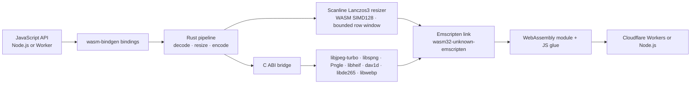

# Mutables Image Optimizer

[](https://www.npmjs.com/package/@mutables.app/image-optimizer)
[](https://www.npmjs.com/package/@mutables.app/image-computer)

**New in v0.4.0:** eligible Adam7/interlaced PNG downscales use bounded pass callbacks, avoiding a full-resolution source buffer for inputs up to 48 megapixels when the callback accumulator fits 48 MiB. **Added in v0.3.0:** HEIC/HEIF and AVIF input, including tiled HEIF grids up to 48 megapixels; lowzag-compatible progressive JPEG resizing up to 48 megapixels; and a 12-megapixel cap for non-grid HEIC/HEIF and AVIF images.

An image-processing pipeline written in Rust and compiled to WebAssembly for Node.js and Cloudflare Workers. It links JPEG, PNG, HEIF/HEIC, AVIF, and WebP codec libraries into the same Emscripten module as the Rust resize pipeline, so the image pixels stay inside WASM instead of crossing between JavaScript libraries at each stage.

```js
import { image } from '@mutables.app/image-optimizer';

const webp = await image(inputBytes)
  .resize(800, 600, { fit: 'inside', withoutEnlargement: true })
  .webp({ quality: 80, speed: 'fast' })
  .bytes();
```

`speed: 'fast'` selects a faster internal WebP encoder setting and enables scaled JPEG decoding for resized images when the target permits it. Lowzag-compatible progressive JPEGs can be resized up to 48 megapixels using scale-aware coefficient decoding. Other progressive/multi-scan JPEGs support up to 48 megapixels when coefficient planes fit the 64 MiB guard; CMYK progressive JPEGs use Lowzag reduced-coefficient decoding; YCCK stays on the buffered path. Both remain capped at 12 megapixels. Adam7 PNGs support up to 48 megapixels through Pngle callbacks when the destination accumulator fits 48 MiB; the libspng full-frame fallback is limited to 12 megapixels. Baseline JPEG and non-interlaced PNG inputs support up to 48 megapixels. `maxPixels` bounds the output (8 million by default). PNG inputs and `lossless: true` requests retain full-resolution source decoding. Omit `speed` to keep the existing WebP encoder setting; scanline processing applies in both modes. The fast path can produce larger files; the trade-off depends on the image. `.blob()` returns an `image/webp` Blob, or `image/jpeg` after `.jpeg()`. Image work runs synchronously in the isolate, inside the returned promise.

## Architecture

The project uses the `wasm32-unknown-emscripten` Rust target with wasm-bindgen’s Emscripten integration. Emscripten links the Rust pipeline and native codec libraries compiled for WebAssembly into one module; the generated JavaScript glue loads that module in Workers or Node.js. This is the integration described in [Cloudflare’s Emscripten target announcement](https://blog.cloudflare.com/rust-workers-emscripten-target/).



JPEG, PNG, HEIF/HEIC and AVIF decoding, resizing, and WebP/JPEG encoding execute in the compiled module. Baseline JPEG and non-interlaced PNG inputs are decoded sequentially. Non-enlarging Adam7 PNG downscales whose float accumulator fits 48 MiB use Pngle's callbacks and scatter pixels through Lanczos weights into the resized destination; other Adam7 outputs use libspng's full-frame compatibility path. Non-grid HEIF/HEIC and AVIF currently decode to a full RGBA source surface and remain capped at 12 megapixels. Tiled HEIF grids decode one tile row at a time and support up to 48 megapixels; tiled AVIF remains capped at 48 megapixels. Row-based decoders use the Rust Lanczos3 resizer, which retains a bounded set of rows and uses premultiplied alpha through both passes, with SIMD128 for four-channel convolution. Both resizers run for the default and `speed: 'fast'` settings.

WebP encoding needs the complete **resized** RGBA image; the source image is not accumulated by the row resizer. JPEG output feeds each resized row directly into a baseline libjpeg-turbo encoder, with standard Huffman tables and 4:2:0 subsampling. Input and encoded output bytes are still buffered by `.bytes()`/`.blob()`; this is internal pixel processing, not a streaming HTTP API.

Supported progressive JPEGs use lowzag's reduced coefficient storage; unsupported progressive/multi-scan JPEGs still require full coefficient storage. Adam7 PNGs use Pngle's scanline-sized decoder state for eligible downscales, with a full-frame fallback for other output sizes. The old `fast_image_resize` implementation remains only as a low-level benchmark reference, not the public processing path. The codec libraries are **compiled to WebAssembly**; they are not native host binaries running outside the Worker sandbox. Workers load the Wasm module statically. Node.js uses a separate file-based loader. The optional Computer adapter sits around the same optimizer and reads and writes files through `workspace.fs`.

Cloudflare describes the Emscripten Rust target support as an experimental preview. This project demonstrates the image-processing use case; it does not imply native machine-code execution or guarantee a performance gain over other Workers image libraries. HEIF decoding adds LGPL-licensed libheif and libde265, plus BSD-licensed dav1d for AVIF decoding; their license notices are included in the optimizer package.

## Packages

### [`@mutables.app/image-optimizer`](https://www.npmjs.com/package/@mutables.app/image-optimizer)

Accepts a `Blob`, `ArrayBuffer`, or typed array. JPEG, PNG, HEIF/HEIC, and AVIF input are sniffed automatically. Non-grid HEIF/HEIC and AVIF input is capped at 12 megapixels because decoding requires a full source image in memory; tiled HEIF grids support up to 48 megapixels and tiled AVIF grids up to 48 megapixels. Width-only resizing preserves aspect ratio; two dimensions default to `fill`.

```js
import { image } from '@mutables.app/image-optimizer';

const bytes = await image(inputBytes)
  .resize(800, 600, { fit: 'inside', withoutEnlargement: true })
  .webp({ quality: 80 })
  .bytes();
```

JPEG output uses the same resize options:

```js
const jpeg = await image(inputBytes)
  .resize(1200, 1200, { fit: 'inside', withoutEnlargement: true })
  .jpeg({ quality: 80 }) // optional speed: 'fast' enables scaled JPEG decoding
  .bytes();
```

JPEG has no alpha: transparent pixels are composited onto white. `.webp({lossless:true})` selects lossless WebP encoding; resizing itself still changes pixels. JPEG output is baseline lossy JPEG.

### [`@mutables.app/image-computer`](https://www.npmjs.com/package/@mutables.app/image-computer)

An optional adapter for [Cloudflare Computer](https://www.npmjs.com/package/@cloudflare/computer). It reads an image from the Computer workspace, runs the same WASM optimizer in the Worker, then writes the result back to the workspace filesystem.

```js
import { optimizeWorkspaceImage } from '@mutables.app/image-computer';

await optimizeWorkspaceImage(workspace, '/input.jpg', '/output.webp', {
  width: 800,
  height: 600,
  fit: 'inside',
  quality: 80,
  speed: 'fast',
});
```

Set `format: 'jpeg'` for JPEG output; WebP is the default. The returned `contentType` matches the selected format.

The adapter accepts a Computer Workspace or compatible object with `fs.readFile` and `fs.writeFile`. Streamed reads are bounded before buffering. Input and output paths must differ; an existing output file is overwritten.

## Performance evidence

The published v0.1.0 Worker benchmark (before scanlines) compares two internal WebP encoder settings on three photos at 320, 800, and 1600 pixels. All 288 image requests returned valid WebP. The `speed: 'fast'` setting had lower median CPU in six of nine image-size cases and in all three 1600-pixel cases, while its files were about 2–12% larger. CPU traces were sampled and uneven across cases. These results are preliminary, image-specific measurements—not a comparison against Bun or other optimizers. See [the full benchmark notes](benchmarks/experiments/RESULTS.md). These CPU results do not establish the performance of the new row pipeline; [scanline comparisons](benchmarks/scanlines/RESULTS.md) are tracked separately.

## Limits

- JPEG, PNG, HEIC/HEIF, and AVIF input; WebP and JPEG output. No animation, rotation, or metadata API.

| Input type | Maximum source pixels | Decode path | WASM linear-memory capacity | Cloudflare isolate memory (max sampled) |
| --- | ---: | --- | ---: | ---: |
| Baseline JPEG | 48 MP | Sequential scanline decode; eligible resized JPEGs can use scaled decode with `speed: 'fast'`. | 16 MiB | 36.14 MiB |
| Non-interlaced PNG | 48 MP | Sequential scanline decode. | 16 MiB | 21.17 MiB |
| Lowzag-compatible progressive JPEG | 48 MP | Reduced coefficient decode when resizing; coefficient planes are checked before full-resolution fallback. | 27.75 MiB | 43.23 MiB |
| Other progressive or multi-scan JPEG | 48 MP | Buffered codec compatibility path; coefficient planes above 64 MiB are rejected before allocation. | 44.13 MiB (12 MP arithmetic-coded sample) | 49.27 MiB (12 MP arithmetic-coded sample) |
| CMYK progressive JPEG | 12 MP | Lowzag reduced coefficient planes. | 19.25 MiB | 24.34 MiB (5 current-build requests); old build 117.72 MiB (1 request) |
| YCCK progressive JPEG | 12 MP | Buffered coefficient compatibility path. | 71.56 MiB | 76.49 MiB (1 request) |
| Adam7/interlaced PNG | 48 MP | Pngle callback downscaling with a <=48 MiB accumulator; full-frame fallback is limited to 12 MP. | 25.25 MiB | 46.07 MiB |
| Non-grid HEIC/HEIF | 12 MP | libde265 (HEVC); decodes the full source image into memory. | 97.94 MiB | 102.66 MiB |
| Non-grid AVIF | 12 MP | dav1d (AV1); decodes the full source image into memory. | 90.25 MiB | 95.16 MiB |
| Tiled/grid HEIC/HEIF | 48 MP | libde265 (HEVC); decodes one tile row at a time. | 49 MiB | 54.97 MiB |
| Tiled/grid AVIF | 48 MP | dav1d (AV1); decodes one tile row at a time. | No fixture available | Not measured |

All formats share a 20 MiB input limit and a 16,383-pixel dimension limit. The default output pixel limit (`maxPixels`) is 8 MP and can be raised to 16 MP. Decoder limits depend on path and output size; Adam7 inputs above 12 MP require callback downscaling within the 48 MiB accumulator limit. WASM capacity is not total Worker memory. Cloudflare's per-invocation isolate-memory metric includes shared JavaScript and WebAssembly memory, but is sampled at invocation time rather than measuring exact peak memory. Cloudflare Worker isolates have a 128 MiB total limit.

Worker measurements in the table use synthetic fixtures and 800×600 WebP output. A fresh Worker handled each fixture; these tests used a 30,000 ms CPU ceiling, while the normal experiment Worker uses 1,000 ms and may hit that CPU limit on large inputs. The Cloudflare values are `memoryUsageBytesP99` samples from Workers Analytics, correlated by request time and colo because temporary Worker names were returned as `__unknown__`. Each format has one successful request except CMYK, which has five current-build samples; treat the table values as observed maxima, not guaranteed peaks. The CMYK path used 19.25 MiB of WASM capacity and up to 24.34 MiB of total isolate memory in those samples, versus 112.69 MiB and 117.72 MiB for one old-build request. YCCK remains on buffered decoding and measured 76.49 MiB total isolate memory for one 12 MP request. The regression test caps reduced CMYK decoding at 64 MiB of WASM capacity. The other progressive/multi-scan measurement uses a 12 MP arithmetic-coded fixture, which bypasses Lowzag; no tiled AVIF fixture is available. See [the Worker measurements and fixture results](benchmarks/decoder-memory-worker.json); rerun with `node scripts/benchmark-decoder-memory-worker.mjs`.

## Decoder memory roadmap

The next memory investigation is reducing the full-resolution decode cost for non-grid HEIC/HEIF and AVIF while keeping their 12 MP input limits. Current Worker samples are 102.66 MiB for HEIC/HEIF and 95.16 MiB for AVIF. Candidate experiments are to avoid an extra full-size RGBA surface where the codec permits it, and to evaluate decoder-side reduced-resolution or custom-buffer options for libde265 and dav1d. These are investigation directions, not confirmed capabilities. Any change must be measured in a real Worker for total isolate memory, WASM capacity, CPU time, and output correctness before changing the limits.

- PNG alpha is preserved in WebP; JPEG composites onto white. EXIF orientation and ICC color management are not applied; metadata is not copied. JPEGs with decoder warnings are rejected.
- Resizing uses scanline Lanczos3 with premultiplied alpha. `speed: 'fast'` enables scaled JPEG decoding for eligible resized lossy requests.

## Development

Prerequisites: Python 3.12+, CMake 3.16+, Make, Rust beta with `wasm32-unknown-emscripten`, Emscripten **6.0.10**, wasm-bindgen CLI **0.2.129**, and Pillow for independent image verification in tests. The build downloads pinned codec source releases. Set `EMSDK` to the SDK directory and `EM_CONFIG` to its generated config file; set `CMAKE` if CMake is outside `PATH`.

```sh
export EMSDK=/path/to/emsdk
export EM_CONFIG=/path/to/emscripten.config
./scripts/build.sh
npm test
npm run check:worker
```

Run `node scripts/benchmark-scanlines.mjs` for matched local A/B measurements in separate processes. It records local CPU, wall time, high-water WASM memory capacity, row-storage estimates and output sizes. This is separate from deployed Cloudflare CPU measurements.

To try the local Worker and Computer integration:

```sh
npm install
npm run dev
curl -X POST --data-binary @test/fixtures/input.jpg 'http://localhost:8787/optimize?width=80&speed=fast' -o /tmp/direct.webp
```

`npm run test:worker` exercises the Computer storage flow while the dev server is running. The Worker example has no authentication or workspace authorization; secure it before exposing it. Build details, codec flags, test requirements, and benchmark artifacts are documented in the repository.

This repository contains source packages and examples; it does not deploy or operate a public image-processing service. No Cloudflare deployment is performed by the build or test scripts.
