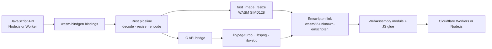

# Mutables Image Optimizer

An image-processing pipeline written in Rust and compiled to WebAssembly for Node.js and Cloudflare Workers. It links JPEG, PNG, and WebP codec libraries into the same Emscripten module as the Rust resize pipeline, so the image pixels stay inside WASM instead of crossing between JavaScript libraries at each stage.

```js
import { image } from '@mutables.app/image-optimizer';

const webp = await image(inputBytes)
  .resize(800, 600, { fit: 'inside', withoutEnlargement: true })
  .webp({ quality: 80, speed: 'fast' })
  .bytes();
```

`speed: 'fast'` selects an internal encoder setting. Omit `speed` to keep the existing default. The fast path can produce larger files; the trade-off depends on the image. `.blob()` returns an `image/webp` Blob. Image work runs synchronously in the isolate, inside the returned promise.

## Architecture

The project uses the `wasm32-unknown-emscripten` Rust target with wasm-bindgen’s Emscripten integration. Emscripten links the Rust pipeline and native codec libraries compiled for WebAssembly into one module; the generated JavaScript glue loads that module in Workers or Node.js. This is the integration described in [Cloudflare’s Emscripten target announcement](https://blog.cloudflare.com/rust-workers-emscripten-target/).



JPEG and PNG decoding, resizing, and WebP encoding execute in the compiled module. The codec libraries are **compiled to WebAssembly**; they are not native host binaries running outside the Worker sandbox. Workers load the Wasm module statically. Node.js uses a separate file-based loader. The optional Computer adapter sits around the same optimizer and reads and writes files through `workspace.fs`.

Cloudflare describes the Emscripten Rust target support as an experimental preview. This project demonstrates the image-processing use case; it does not imply native machine-code execution or guarantee a performance gain over other Workers image libraries.

## Packages

### `@mutables.app/image-optimizer`

Accepts a `Blob`, `ArrayBuffer`, or typed array. JPEG and PNG input are sniffed automatically. Width-only resizing preserves aspect ratio; two dimensions default to `fill`.

```js
import { image } from '@mutables.app/image-optimizer';

const bytes = await image(inputBytes)
  .resize(800, 600, { fit: 'inside', withoutEnlargement: true })
  .webp({ quality: 80 })
  .bytes();
```

### `@mutables.app/image-computer`

An optional adapter for [Cloudflare Computer](https://www.npmjs.com/package/@cloudflare/computer). It reads an image from the Computer workspace, runs the same WASM optimizer in the Worker, then writes the WebP back to the workspace filesystem.

```js
import { optimizeWorkspaceImage } from '@mutables.app/image-computer';

await optimizeWorkspaceImage(workspace, '/input.jpg', '/output.webp', {
  width: 800,
  height: 600,
  fit: 'inside',
  quality: 80,
  speed: 'fast',
});
```

The adapter accepts a Computer Workspace or compatible object with `fs.readFile` and `fs.writeFile`. Streamed reads are bounded before buffering. Input and output paths must differ; an existing output file is overwritten.

## Performance evidence

The current Worker benchmark compares two internal WebP encoder settings on three photos at 320, 800, and 1600 pixels. All 288 image requests returned valid WebP. The `speed: 'fast'` setting had lower median CPU in six of nine image-size cases and in all three 1600-pixel cases, while its files were about 2–12% larger. CPU traces were sampled and uneven across cases. These results are preliminary, image-specific measurements—not a comparison against Bun or other optimizers. See [the full benchmark notes](benchmarks/experiments/RESULTS.md).

## Limits

- JPEG and PNG input; WebP output. No animation, HEIC, AVIF, rotation, or metadata API.
- 20 MiB maximum input. The default pixel limit is 8 million and can be raised to 16 million. Source and output dimensions are limited to 16383; WASM memory is capped at 256 MiB.
- PNG alpha is preserved. EXIF orientation and ICC color management are not applied; metadata is not copied. JPEGs with decoder warnings are rejected.
- Resizing uses the default Lanczos3 filter with alpha handling. Scaled JPEG decoding remains experimental and is not exposed in the public API.

## Development

Prerequisites: Python 3.12+, CMake 3.16+, Make, Rust beta with `wasm32-unknown-emscripten`, Emscripten **6.0.10**, and wasm-bindgen CLI **0.2.129**. The build downloads pinned codec source releases. Set `EMSDK` to the SDK directory and `EM_CONFIG` to its generated config file; set `CMAKE` if CMake is outside `PATH`.

```sh
export EMSDK=/path/to/emsdk
export EM_CONFIG=/path/to/emscripten.config
./scripts/build.sh
npm test
npm run check:worker
```

To try the local Worker and Computer integration:

```sh
npm install
npm run dev
curl -X POST --data-binary @test/fixtures/input.jpg 'http://localhost:8787/optimize?width=80&speed=fast' -o /tmp/direct.webp
```

`npm run test:worker` exercises the Computer storage flow while the dev server is running. The Worker example has no authentication or workspace authorization; secure it before exposing it. Build details, codec flags, test requirements, and benchmark artifacts are documented in the repository.

This repository contains source packages and examples; it does not deploy or operate a public image-processing service. No Cloudflare deployment is performed by the build or test scripts.
